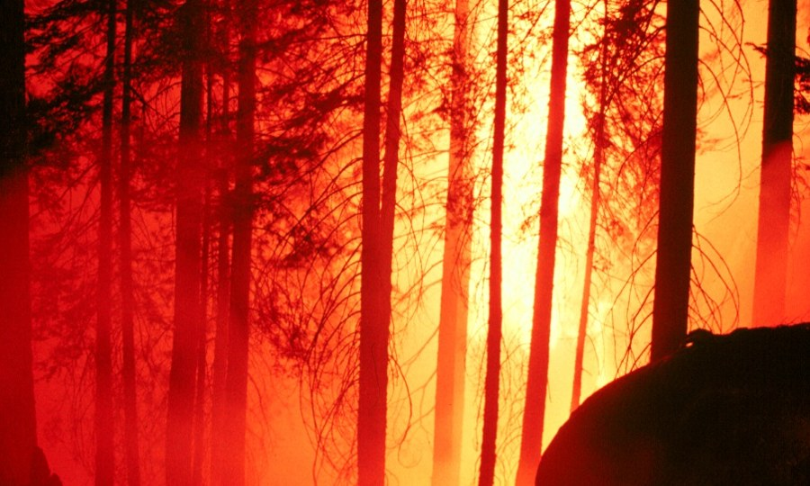
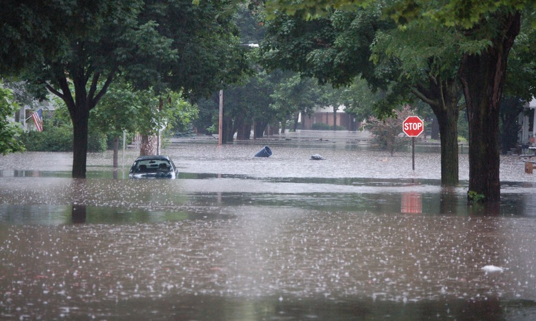

# CrisisConnect

**Community Emergency Alerts**

CrisisConnect pairs visual hazard detection with a browser interface for live community alerts. The source repository is private.

## Detecting fire and flooding

I integrated YOLOv8 to detect signs of fire and flooding in imagery.

| Fire | Flooding |
| :--- | :--- |
|  |  |
| Wildfire in the western United States. [Nathan Stephenson, USGS](https://www.usgs.gov/media/images/fire-night) | A neighborhood during the 2008 Midwest floods. [U.S. Geological Survey](https://www.usgs.gov/media/images/flooded-neighborhood) |

*Public-domain reference photographs, cropped for this page.*

## Writing the alert

Alert generation starts with a lookup. I used LangChain to retrieve relevant material from ChromaDB and pass it to the model as context for the message it writes. That lookup is the retrieval step in retrieval-augmented generation (RAG).

## Getting the alert to the browser

The React frontend keeps a WebSocket connection open to FastAPI. When a new alert is available, FastAPI pushes the message to the browser so it can appear without a page refresh.
